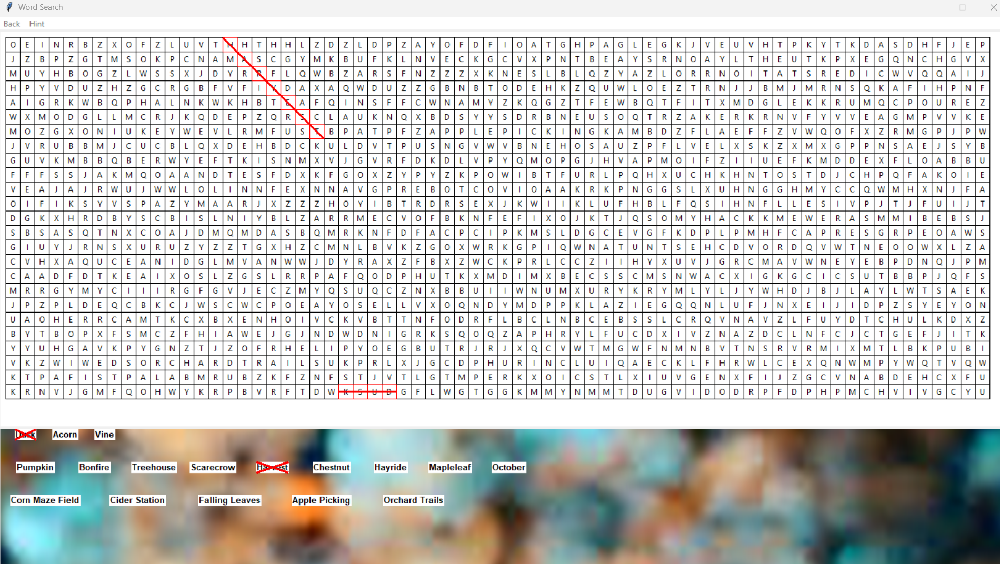

# Word Search Game

A desktop word search game built in Python with Tkinter. Pick a themed category and the game builds a fresh puzzle each time.

## Features
- 9 categories (Fall, Spring, Summer, Winter, Games, Sports, Food, Animals, Colors) loaded from `words.json`
- 17 words per puzzle, placed at random in a 68x25 grid in all 8 directions, including diagonals and backwards
- Placement collision detection, plus a recursive check that regenerates the filler letters until every word appears exactly once on the board
- Two ways to play: drag across the letters, or click the first and last letter
- Found words are struck through on the board and in the word bank, with a win message when you finish
- Hint button that highlights a random word

## Run it
Requires Python 3.8+ with Tkinter (included in most Python installs).

    pip install -r requirements.txt
    python game.py

Run it from the project folder so it can find `words.json` and the banner images.

## Project files
- `game.py`: game code
- `words.json`: word lists for each category, split into short, medium, and long words
- `*.png`: category banner images

## Screenshot

## Credits
- Banner images are from [Pexels](https://www.pexels.com).
- The scrollable category menu (`ScrollableFrame`) was generated with AI assistance. All other code and design are my own.
